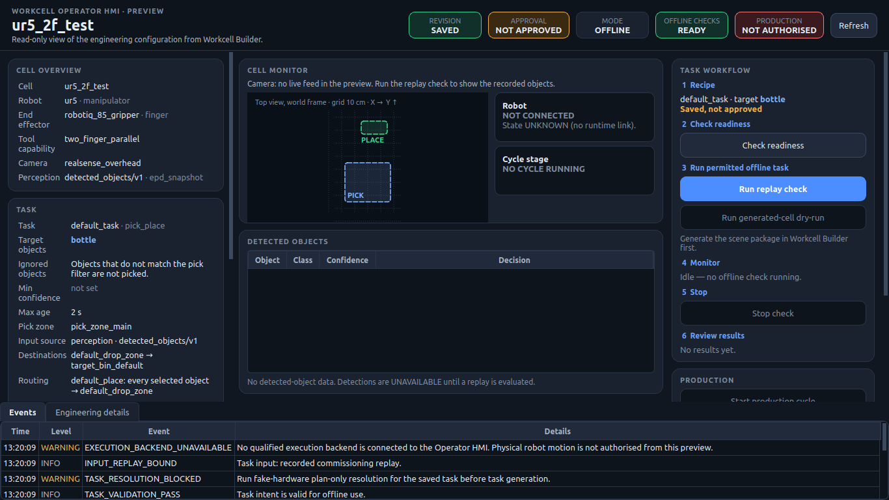
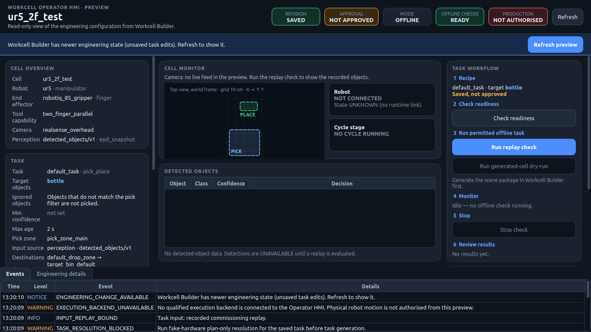
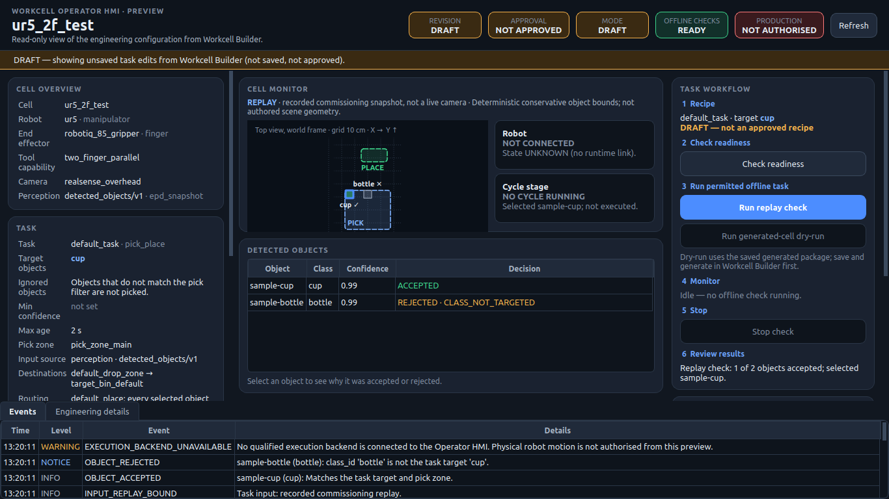
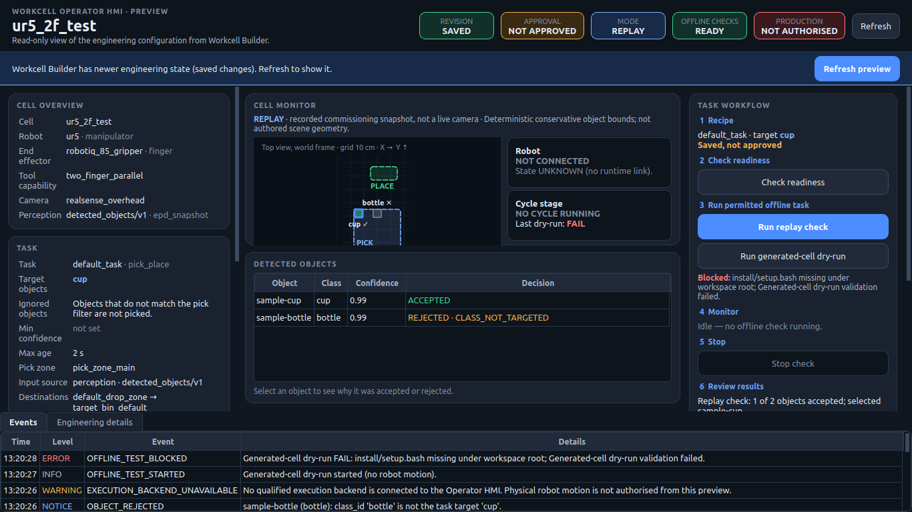
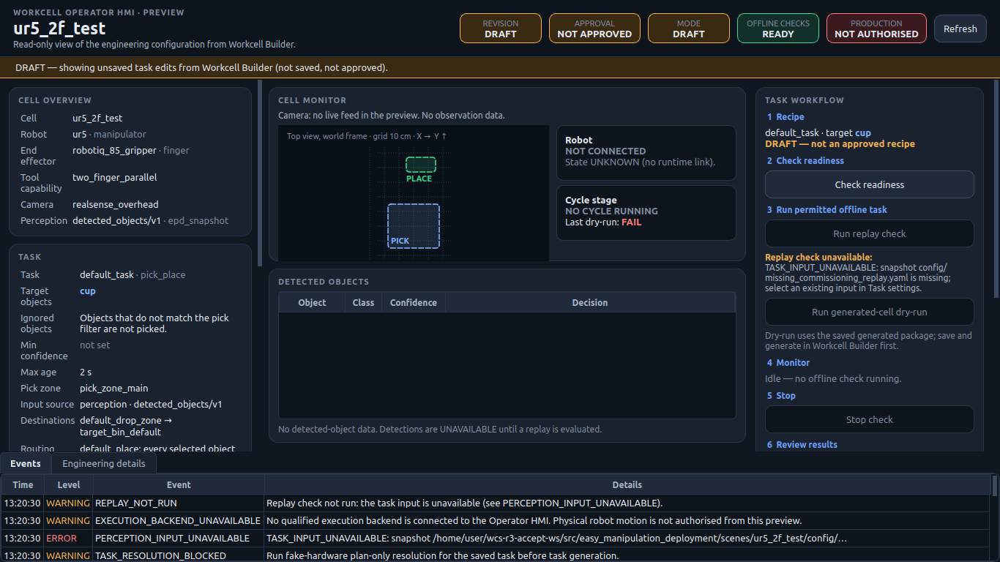
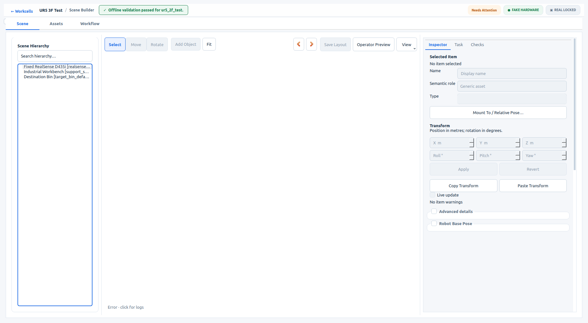
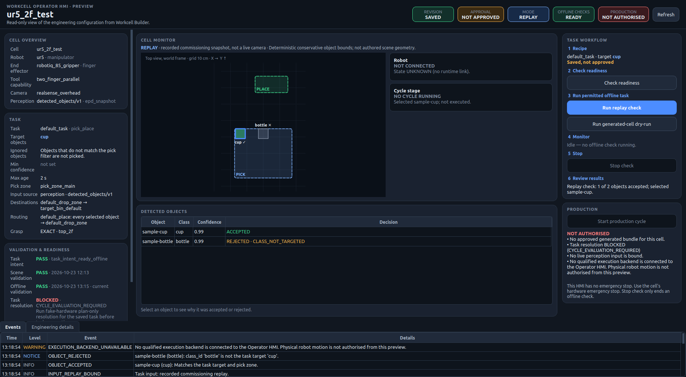

# Operator HMI preview acceptance (v1)

Hardware-free acceptance of the [R3 Operator HMI preview](../manuals/R3_OPERATOR_HMI_PREVIEW.md)
on `ur5_2f_test`. The real Workcell Builder drives the real `workcell_operator_hmi` process in a
disposable workspace copy. The HMI is operated only through its own buttons.

| Run | Result | Evidence |
|---|---|---|
| Authoring | PASS, 38/38 checks | [authoring.json](operator-hmi-preview-v1/authoring.json) |
| Reopen | PASS, 15/15 checks | [reopen.json](operator-hmi-preview-v1/reopen.json) |

## What the evidence shows

- **Entry points.** Operator Preview is on the Scene Builder toolbar, is a registered Scene
  Builder action, and is in the Home **More ▾** menu. It opens the HMI as a separate process while
  the Builder stays editable.
- **Saved revision.** With a clean editor the HMI shows SAVED, target `bottle`, the configured
  destination, and PRODUCTION · NOT AUTHORISED.
- **Draft edit.**
  - Changing the target class to `cup` raises *Workcell Builder has newer engineering state*. The
    HMI keeps its loaded view until refreshed.
  - Operator Preview then shows DRAFT `cup` in the same HMI process.
  - The replay check accepts `sample-cup` and rejects `sample-bottle` with `CLASS_NOT_TARGETED`.
- **Save and refresh.** After Save and the HMI's own Refresh, the HMI shows SAVED / REPLAY `cup`.
  The normalized intent SHA-256 changes from `2de253a5…` to `d176de2f…`.
- **Builder workflow.** Generate, then Validate, passes offline validation. The HMI's
  generated-cell dry-run becomes available and reports its real preflight blockers verbatim:
  - `install/setup.bash missing under workspace root` (the disposable workspace is not
    colcon-built);
  - `Generated-cell dry-run validation failed.`
- **Engineering error.** Binding a commissioning replay that does not exist shows
  `TASK_INPUT_UNAVAILABLE` and disables the replay check. A command to press the replay check is
  rejected (`control disabled`), and so is one to press Start production.
- **Lifecycle.**
  - Closing the HMI leaves the Builder open and usable.
  - Five open/close cycles leave 0 HMI and 0 adapter processes.
  - In the reopen run the HMI is still open when the Builder exits; the Builder takes it down.
- **Recovery.** The reopen run recovers the saved intent SHA-256 `d176de2f…` and target `cup`.
- **No motion.** `robot_motion_commanded: false` and `execution_goals_sent: 0` in both runs.

## Screens

| | |
|---|---|
|  Saved revision, 1366×768 |  Builder has newer state |
|  Draft + replay check |  Generated-cell dry-run blockers |
|  Missing task input |  Builder after the HMI closes |
|  Full HD, standalone, saved + replay | |

Builder widget grabs do not include the embedded Web3D canvas, which therefore appears blank in
`10_builder_after_hmi_close.png`.

## Reproduce

```bash
# <ws>/src/easy_manipulation_deployment is a disposable copy of this checkout
WORKCELL_WORKSPACE_ROOT=<ws> workcell_builder --operator-preview-acceptance \
  --smoke-output <out> --scene ur5_2f_test --workspace <ws>
WORKCELL_WORKSPACE_ROOT=<ws> workcell_builder --operator-preview-acceptance \
  --smoke-output <out> --scene ur5_2f_test --workspace <ws> --reopen
```
