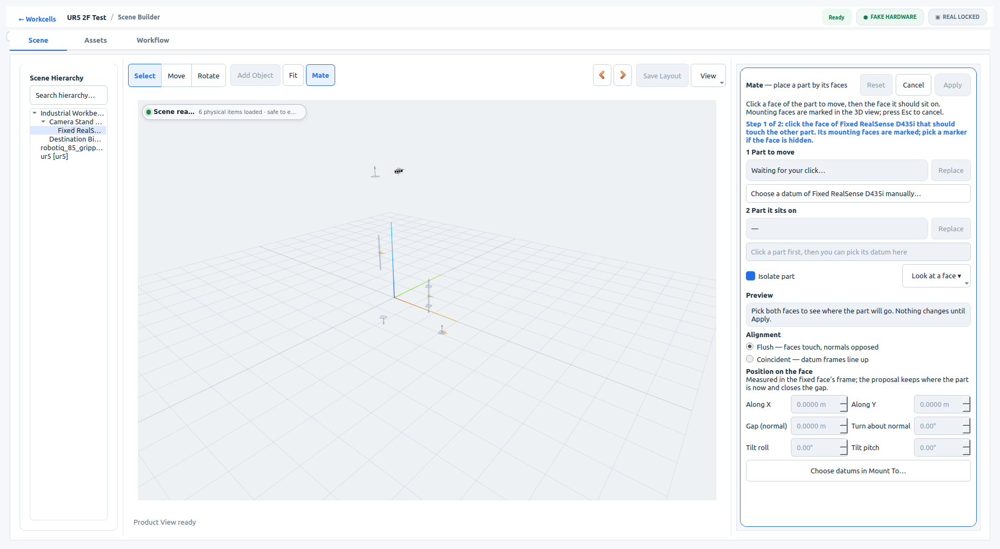
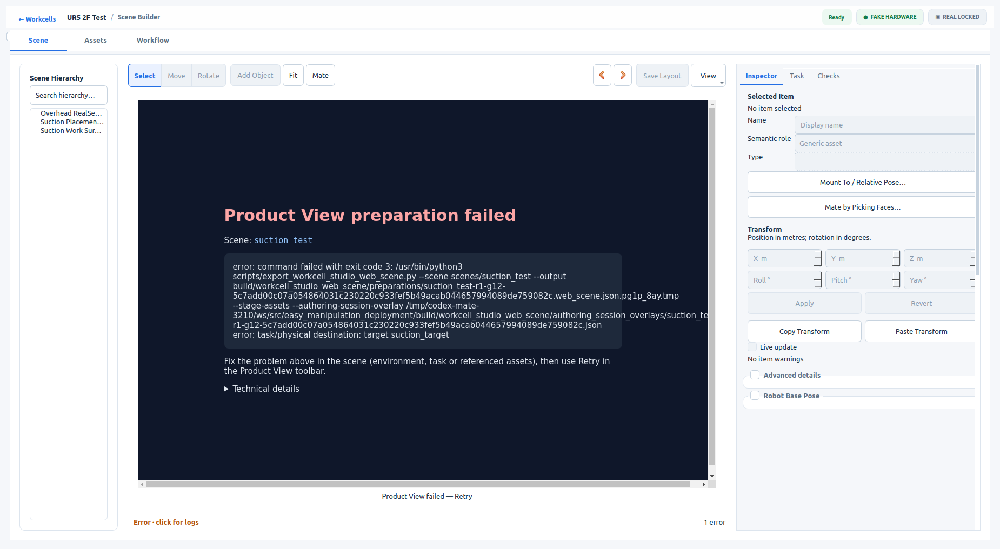

# Visual Mate hardening: live lifecycle acceptance

PR #3210, production source `d4e49f83`. This verification changes only the existing
acceptance runner and evidence. The real Qt/WebEngine application was rebuilt on
ROS 2 Humble and run on X11 with an isolated Qt configuration and disposable
copies of `ur5_2f_test` and `suction_test`.

- **Authoring:** all 52 steps PASS, process exit 0. Includes exact offset editing,
  compound camera isolation/picking, Save, disk read-back, Generate and Validate.
- **Reopen:** all 21 steps PASS, process exit 0. Saved relations and the exact
  compound camera pose match disk; inspection leaves the layout clean.
- **Reload mid-Mate:** after consuming pick/hover/Esc counters `(1, 3, 2)`, the
  test calls the real `QWebEngineView::reload()`. Builder restores Mate, datum
  markers and camera isolation. A real stand raycast returns `NO_ASSET`. The
  first mouse pick reaches the Qt controller; the first Esc cancels, consuming
  restarted browser cancel counter `1`. Authored state remains unchanged.
- **Cell switching:** each path starts with a valid proposal and Apply enabled.
  The cell-list handler and Home/Open route both cancel Mate and disable Apply.
  Clicking cancelled Apply leaves both cells' environment and authored-layout
  file hashes unchanged. The test returns to the saved original cell.

Fresh focused checks: 5 pytest regressions, 9 Mate policy gtests, ROS-RPY Node
regression and bundle freshness all pass. Independent review found no blockers
in the product changes or the added acceptance checks.

[Machine-readable results](visual-mate-hardening-v1/evidence.json).





## Reproduce

Use the existing `--visual-mate-acceptance` runner with a disposable repository
copy under `<workspace>/src/easy_manipulation_deployment` containing both scenes.
Source ROS Humble and the workstation underlay; isolate `XDG_CONFIG_HOME`.

```bash
workcell_builder --visual-mate-acceptance --workspace "$WS" --scene ur5_2f_test --smoke-output "$EVIDENCE"
workcell_builder --visual-mate-acceptance --workspace "$WS" --scene ur5_2f_test --smoke-output "$EVIDENCE" --reopen --window-size 1920x1080
```

The full-page reload check is distinct from the same-document scene-reset
regression, which remains covered by the viewer harness. Native GUI results are
retained from the original PR, not rerun here. Known baseline CI failures remain
out of scope. Clean exits in these two runs do not prove the intermittent teardown
issue fixed; #3203 remains separate. No robot execution was launched.
