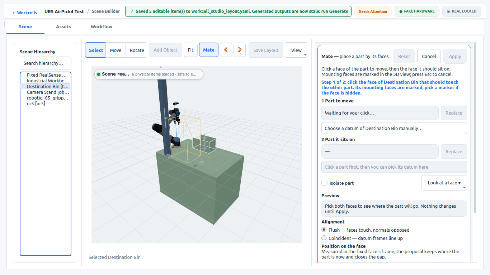
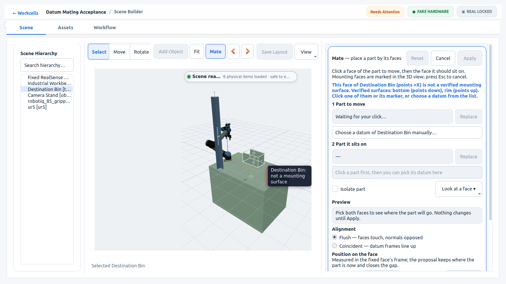
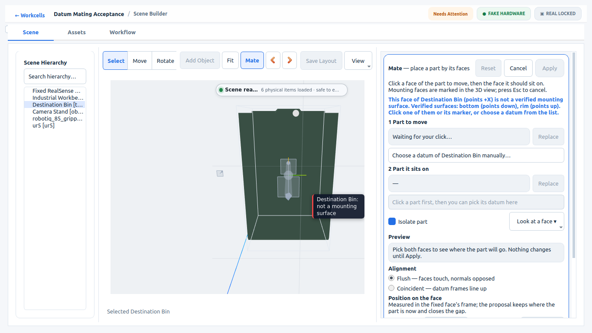
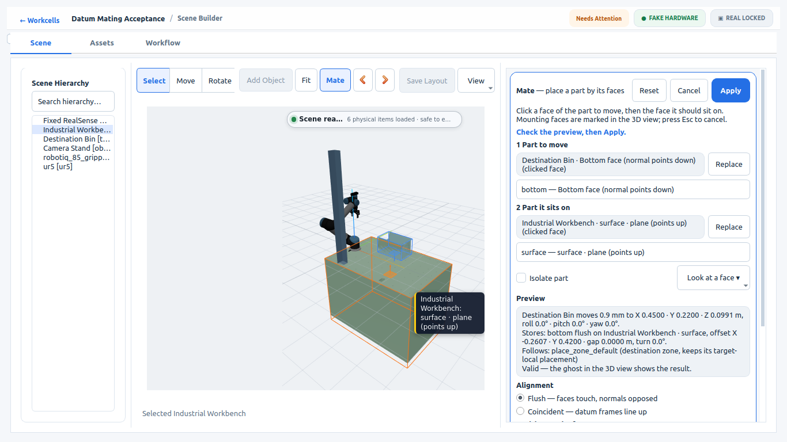
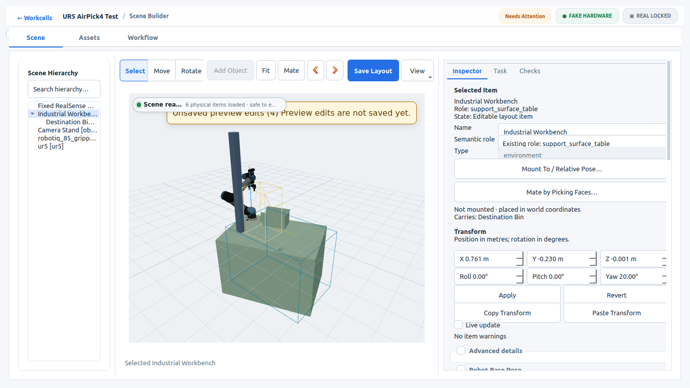
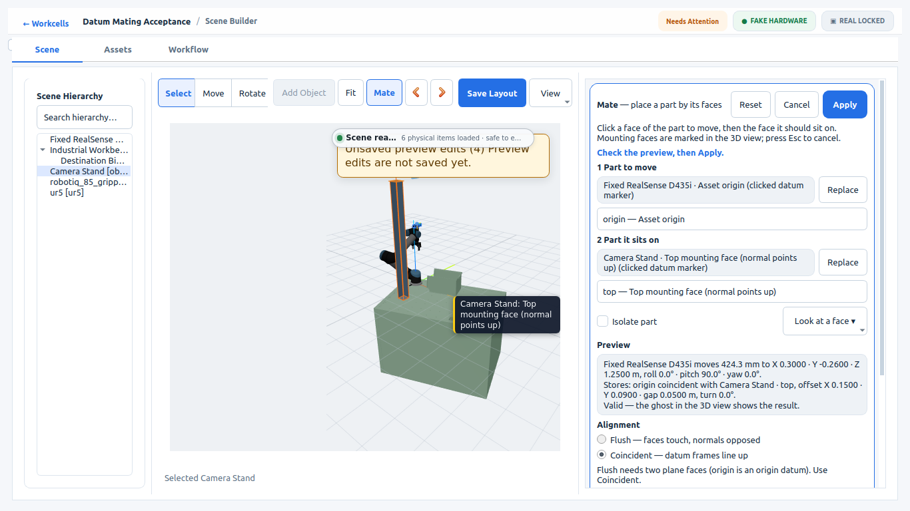
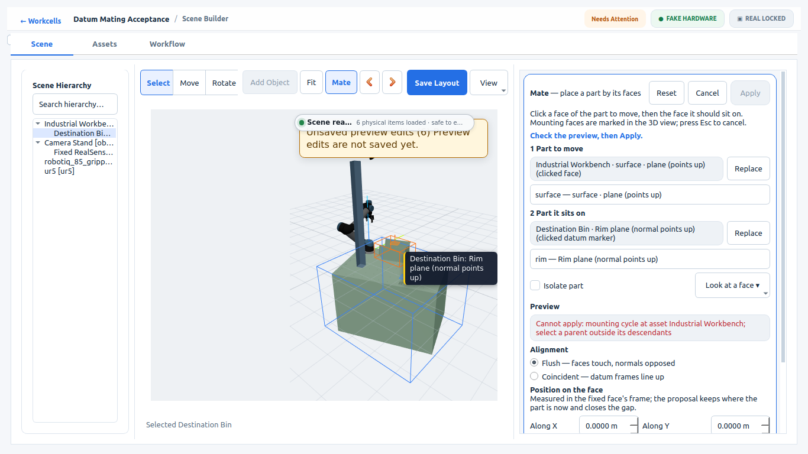
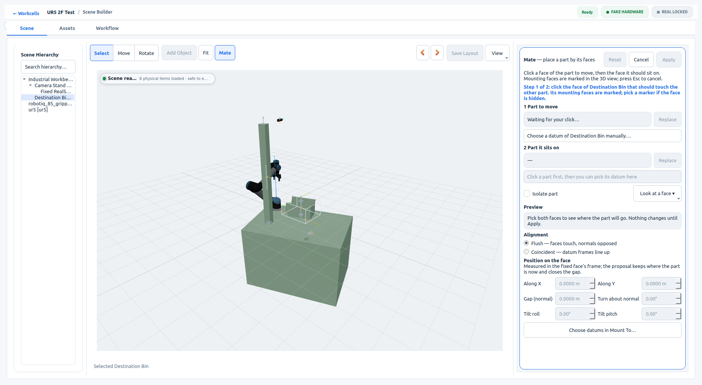
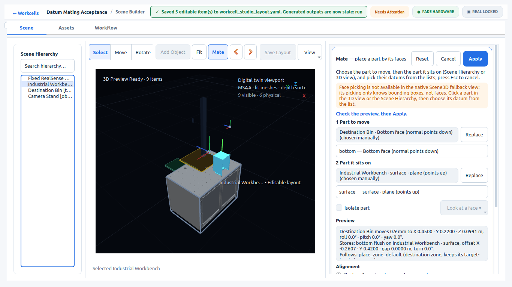

# Visual Mate Selection (v1, R3.2)

Visual Mate is click-driven, CAD-style authoring of the existing fixed mounting / datum-mate relation ([asset-datum-mating-v1](asset-datum-mating-v1.md)). It is not a second mating system:
- `scripts/asset_mounting.py` owns transforms, validation and persistence.
- The new `datum_frames` operation publishes datum world frames for picking.
- The preview and Apply send the same `edit` request the Mount To dialog uses.

User guide: [Visual Mate Selection](../manuals/VISUAL_MATE_SELECTION.md).

## How a click becomes a mate

```text
viewport click ──► MateRawPick {asset, world hit point, face normal, ray, drawn asset pose,
                                geometry source, triangle | datum marker}
                ──► resolve_mate_pick() (include/mate_pick.hpp, one policy for every backend)
                    vs. resolver datum_frames: plane within 10° and 5 mm, else a reason
                ──► MateToolController: child pick, parent pick, Flush/Coincident, seated offset
                ──► asset_mounting.py edit (dry run = preview + ghost; Apply = commit_mounting_request)
```

- **Web3D: viewer side.** The viewer reports raw picks through `getMateState()` with sequence numbers, so a dropped editor poll cannot lose a click. It draws what Builder sends:
  - datum markers at the resolver's frames, drawn on top so hidden datums are reachable;
  - pick highlights;
  - a translucent ghost of the resolver's proposed poses.
- **Web3D: Builder side.**
  - Hovering resolves through the same policy, and the label says what a click would pick.
  - Mate mode blocks the viewer's own selection, gizmo and context menu.
  - Hierarchy clicks choose the part for the current step.
  - Esc cancels.
- **Native Scene3D:** its picking only knows bounding boxes. Face picking is explicitly disabled there with a note in the panel; parts are chosen by click or hierarchy and datums from the list (the retained manual path).

## Evidence

### Workstation, 2026-10-23 (London), `ur5_2f_test`, hardware-free

The real Builder is driven by real Qt mouse events in the Product View, delivered to the WebEngine input widget at projected world points. Each click is preceded by a hover that must resolve to the intended target. Panel controls, Inspector edits, undo/redo, the existing Mount To dialog, Save, Generate and Validate are all exercised. Everything is checked against the resolver, the editor and `environment.yaml`.

| Run | Result | Evidence |
|---|---|---|
| Web3D authoring, 1366×768 | PASS, 42 steps | [authoring.json](visual-mate-selection-v1/authoring.json) |
| Web3D reopen, separate process (1920×1080 requested; the WM clamps it to the 1850×1016 desktop) | PASS | [reopen.json](visual-mate-selection-v1/reopen.json) |
| Native Scene3D fallback, 1366×768 | PASS | [native.json](visual-mate-selection-v1/native.json) |
| Offline projection check | PASS | [projection-check.json](visual-mate-selection-v1/projection-check.json) |
| ROS 2 Humble fake hardware, no motion | PASS | [runtime.json](visual-mate-selection-v1/runtime.json) |

**Scenario A: bin on table.**
1. A click on the bin's side wall is refused: `NO_MATCHING_DATUM`, "not a verified mounting surface", and the manual datum list is offered.
2. With **Isolate part** and **Look at a face → bottom**, a geometry click on the bin bottom resolves to `bottom`: 0.0 mm from the plane, 0° from the normal.
3. A geometry click on the table top resolves to `surface`: 0.3 mm from the reviewed plane.
4. Flush is the default. The seated proposal keeps X/Y and yaw and closes the 0.9 mm gap, so the bin lands at Z 0.0991. The ghost is drawn; the scene and files are unchanged by the preview.
5. Apply records one undoable edit. The flush gap is 2e-18 m with normals opposed.
6. The table is moved +5 cm / −3 cm and turned 20°. The bin keeps its table-local offset (−0.2607, 0.42) exactly and stays flush.

**Scenario B: camera on stand.**
1. A Camera Stand is placed from the Asset Library. A click on the camera body is refused (`NO_PLANE_DATUMS`); its origin marker picks `origin`.
2. The stand is chosen in the hierarchy, isolated, and its top viewed. A click on the stand's top face reaches an inner wall of the inside-out placeholder STL and is refused (`NO_MATCHING_DATUM`). Its `top` datum marker picks the reviewed frame.
3. Origin to plane defaults to Coincident; Flush is disabled with its reason. The offset is set in the panel: 0.15 / 0.09 m, gap 0.05 m, pitch 90°.
4. After Apply, the stand is moved and turned 15°. The camera holds its offset from the stand top (error 0 m), and the bin stays flush.

**Scenario C: invalid mate and recovery.**
1. Started from the hierarchy context menu: table top onto the bin rim. The panel shows the mounting cycle with Apply disabled, and the editor and `environment.yaml` are byte-identical.
2. Self-mating (table onto table) is refused.
3. Replace corrects the pair to stand base flush on table top, which applies.
4. Undo and redo restore exactly. Detach through the existing Mount To dialog keeps the world pose, and undo restores it.
5. The existing Mount To dialog still edits the Mate-authored camera relation (manual path).
6. Save: disk equals the editor for every relation and pose. GUI Generate and Validate then run, and offline validation passes.

**Reopen (separate process).**
- Every ID, relation, offset and world pose equals the authoring session and `environment.yaml`.
- The flush relations hold.
- Selecting the mated bin leaves the layout clean.
- The datum markers draw, and Esc in the 3D view cancels without changes.

**Generated cell.**
- The projection check holds every relation (bin, camera, stand) through the generated environment objects and the MoveIt manifest.
- On fake hardware:
  - the three controllers are active;
  - collision objects sit at the mated world poses;
  - `camera_link` TF equals the authored chain;
  - RViz and mesh markers are up;
  - `execution_goals_sent: 0`.

**Clean shutdown.** All Builder runs exit 0, with no Builder or Product View server processes left.

| | |
|---|---|
|  Mate started: datum markers |  Side wall refused, with reason |
|  Isolate + Look at a face (bin bottom) |  Flush preview with ghost |
|  Table moved, bin follows |  Camera on stand, coincident offset |
|  Cycle rejected, Apply disabled |  Reopened |
|  Native fallback: lists, same preview | |

## Changes found during acceptance

- **Camera mounts are fixtures.** Asset discovery and the Web3D export treated any "camera…" identity as a camera, so the Asset Library Camera Stand became a second camera owner. It was then dropped from the Web3D scene, and reopening the cell failed Product View preparation ("exactly one physical camera owner; found 2"). Camera stands, mounts, brackets, frames, gantries and clamps are now fixtures. Real cameras, and anything with `role: camera`, are unchanged.
- **Runtime script.** `asset_mounting_runtime_acceptance.py` now passes the cell's authored camera pose as xacro arguments when the scene xacro declares `camera_world_xyz` / `camera_world_rpy`, as the generated launch does.

## Reproduce

In a disposable workspace whose `src/easy_manipulation_deployment` is a copy of this checkout, with ROS and the workspace underlay sourced, from the repository root:

```bash
workcell_builder --visual-mate-acceptance --workspace "$WS" --scene ur5_2f_test --smoke-output "$EVIDENCE"
workcell_builder --visual-mate-acceptance --workspace "$WS" --scene ur5_2f_test --smoke-output "$EVIDENCE" --reopen --window-size 1920x1080
WORKCELL_BUILDER_PRODUCT_VIEW_BACKEND=native_scene3d workcell_builder --visual-mate-acceptance --workspace "$WS2" --scene ur5_2f_test --smoke-output "$EVIDENCE/native"
python3 workcell_builder/workcell_builder/test/datum_mating_projection_check.py scenes/ur5_2f_test "$EVIDENCE/projection-check.json"
RMW_IMPLEMENTATION=rmw_cyclonedds_cpp ROS_DOMAIN_ID=87 python3 workcell_builder/workcell_builder/test/asset_mounting_runtime_acceptance.py \
  ur5_2f_test scenes/ur5_2f_test "$EVIDENCE/runtime"   # after colcon build of the generated cell
```

Screenshots are read from the real X11 window (`test/x11_window_capture.py`). Widget grabs cannot see the composited Product View.

## Limits

- **Not a CAD kernel.** Faces are the verified planar datums and the surfaces associated with them; there are no arbitrary mesh, STEP or BREP faces, and no multi-constraint solver or moving joints. The pick contract carries the geometry source and triangle, so face-derived datums can be added later.
- **Compound tilt-plus-yaw rotations in Web3D (fixed after this evidence).** This evidence was recorded while Web3D used three.js `XYZ` Euler order, which refused surface picks on such assets as a pose mismatch. Web3D now uses ROS fixed-axis RPY (three.js `ZYX`) for every pose; see [Visual Mate Selection](../manuals/VISUAL_MATE_SELECTION.md#known-limits). Markers, relations and generated cells were always exact.
- **Pre-existing asset and viewer issues:**
  - The reviewed `camera_stand` placeholder STL is wound inside out.
  - A newly placed library asset is drawn as a live placeholder until the Product View refreshes.
  - The harness-load breadcrumb can show the previously selected cell.
