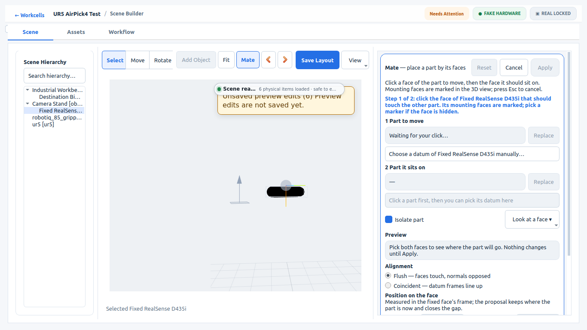
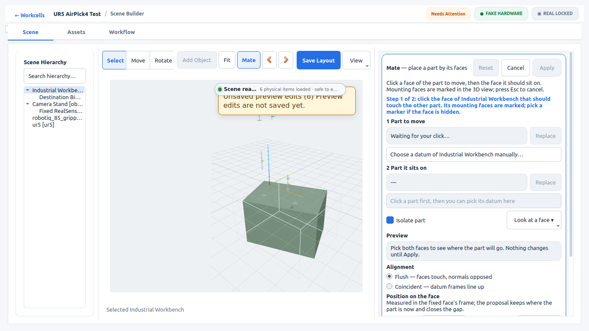
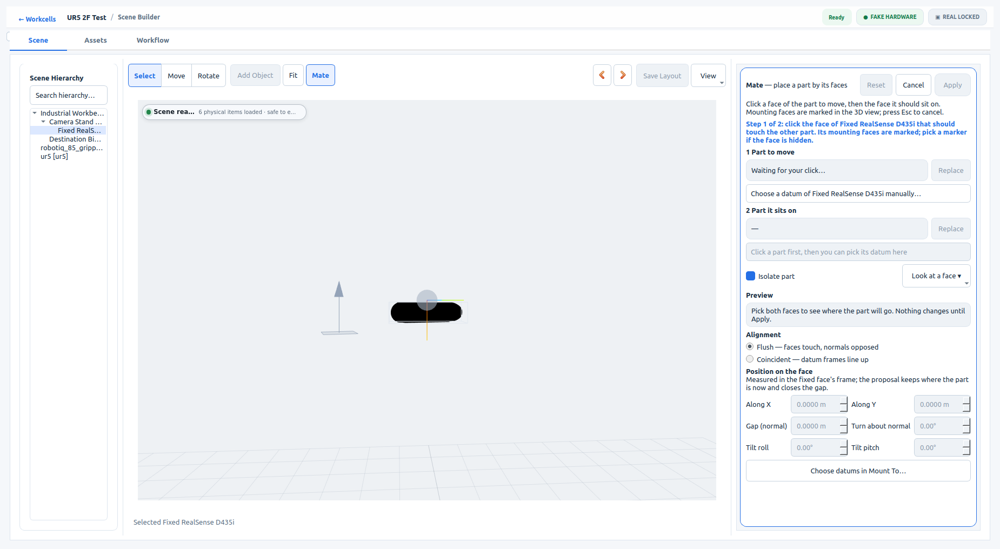

# Web3D mate fixes combined (#3205 + #3206 + #3207): acceptance

Local integration branch `integration/web3d-mate-3205-3206-3207`. It merges #3207 (`384d14a3`) into #3206 (`debb12ef`); #3206 is stacked on #3205 (`abe5781d`). The bundle was regenerated from the combined source. Scene: `ur5_2f_test`. Fake hardware only; `execution_goals_sent: 0`.

The compound-pose step in `--visual-mate-acceptance` now isolates the camera. It previously skipped isolation, because before #3207 isolation hid the camera's reparented D435 mesh. Numbers: [`web3d-mate-integration-v1/evidence.json`](web3d-mate-integration-v1/evidence.json).

## Real GUI (Workcell Builder, embedded Web3D, X11 window capture)

The camera is pitched 90° on the stand turned 15°, giving rpy (0, π/2, 0.2618). `XYZ` order would draw this 21.18° away from its true orientation.

| Check | Authoring | Reopen |
|---|---|---|
| Camera isolated (`isolatedAsset`) | `realsense_overhead` | `realsense_overhead` |
| Isolated body click | D435 mesh surface, owner `realsense_overhead`, `NO_PLANE_DATUMS` | same |
| Drawn vs authored pose | 0.0 mm, 0.0° | 0.0 mm, 0.0° |
| Stand mast while isolated | `NO_ASSET` (hidden) | `NO_ASSET` |
| Stand mast after Isolate off | Camera Stand hit again | Camera Stand hit again |
| Table isolated, top click | `support_surface_table` · `surface` (0.3 mm, 0.0°) | — |
| Cancel | `environment.yaml` and relations unchanged | also layout clean |

**Save, disk read-back and reopen.**
- Disk equals the editor after Save.
- The saved camera has rpy (0, π/2, 0.2618) on parent `object_01`, with stand-local origin (0.15, 0.09, 0.05; pitch π/2).
- After reopen, relations equal disk.
- Selecting the camera reads back `selectedTransform.rpy` (0, π/2, 0.2618) exactly, and the layout stays clean.

**Native Scene3D:** PASS.

**Process exit:** authoring, reopen and native all exited 0. The known teardown SIGSEGV did not recur.

| | | |
|---|---|---|
|  Isolated turned camera: D435 drawn, stand hidden |  Isolated table |  Reopen, isolated camera |

## Harness: production render/pick path with a reparented table

`ur5_2f_test` exports no generated table visual; no catalog scene does. [`build_fixture.py`](web3d-mate-integration-v1/build_fixture.py) builds a disposable fixture:
- a scratch copy of `ur5_2f_test`, with the camera at (0, π/2, 15°) and the table yawed 20°;
- the mesh index and payload generated by the repository's own scripts;
- one **constructed** generated table visual, whose owner-relative transform comes from the exporter's `_parent_to_child_pose`.

[`production_path_isolation.cjs`](web3d-mate-integration-v1/production_path_isolation.cjs) runs the integrated `viewer.js` with:
- `renderScene` (mesh loads replaced by boxes);
- isolation through the editor API (`setMateMode` / `clearMateMode`);
- `mateRaycast` and `pickObject` through a real three.js camera and raycaster.

It checks:
- **Reparenting:** both generated visuals are reparented under their owners. The drawn owner and visual poses match the authored and exported poses (< 1e-6).
- **Camera isolated:** the D435 visual is visible and picked, resolving to `realsense_overhead` at the authored rotation. A ray through the hidden table hits nothing.
- **Switched to the table:** its reparented visual is visible and picked, resolving to `support_surface_table` at the authored rotation. The camera is hidden.
- **Visual isolated directly:** isolating a reparented visual itself keeps its owner visible.
- **Clear:** every root returns to its earlier visibility, and a root hidden before isolation (the bin) stays hidden.
- **Editor selection:** selection through the same raycaster resolves to both owners, the camera RPY reads back exactly, and there are no dirty edits.

The harness passes on the integration branch. It fails on each PR alone:
- **#3206 alone:** isolation hides the D435 visual.
- **#3207 alone:** the camera is drawn 21.18° away from its authored pose.

## Tests

- The same 39 viewer, exporter, placement and mate test files were run on both trees.
  - Base `abe5781d`: 85 failed / 452 passed.
  - Integration: 83 failed / 457 passed / 1 skipped.
  - No new failures. Two pinned tests now pass, and the new #3206 and #3207 tests pass.
- `npm run check:stale-bundle`: current.
- `node tests/test_web3d_mesh_ros_rpy_order.mjs`: passes.

## Reproduce

From the repository root, with ROS and the workspace underlay sourced. GUI runs use a disposable workspace copy and an isolated `XDG_CONFIG_HOME`.

```bash
workcell_builder --visual-mate-acceptance --workspace "$WS" --scene ur5_2f_test --smoke-output "$EVIDENCE"
workcell_builder --visual-mate-acceptance --workspace "$WS" --scene ur5_2f_test --smoke-output "$EVIDENCE" --reopen --window-size 1920x1080
WORKCELL_BUILDER_PRODUCT_VIEW_BACKEND=native_scene3d workcell_builder --visual-mate-acceptance --workspace "$WS2" --scene ur5_2f_test --smoke-output "$EVIDENCE/native"
python3 docs/acceptance/web3d-mate-integration-v1/build_fixture.py . "$SCRATCH"
node docs/acceptance/web3d-mate-integration-v1/production_path_isolation.cjs workcell_studio_web/viewer/viewer.js "$SCRATCH/fixture.web_scene.json" "$SCRATCH/result.json"
```
