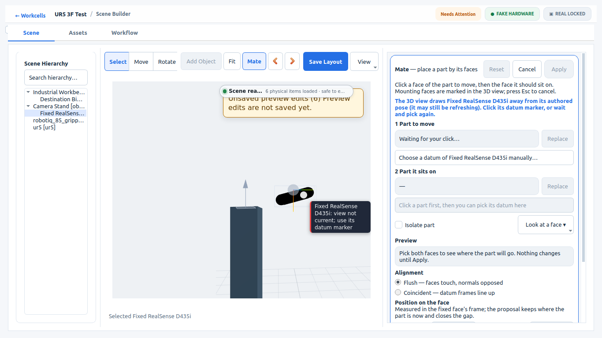
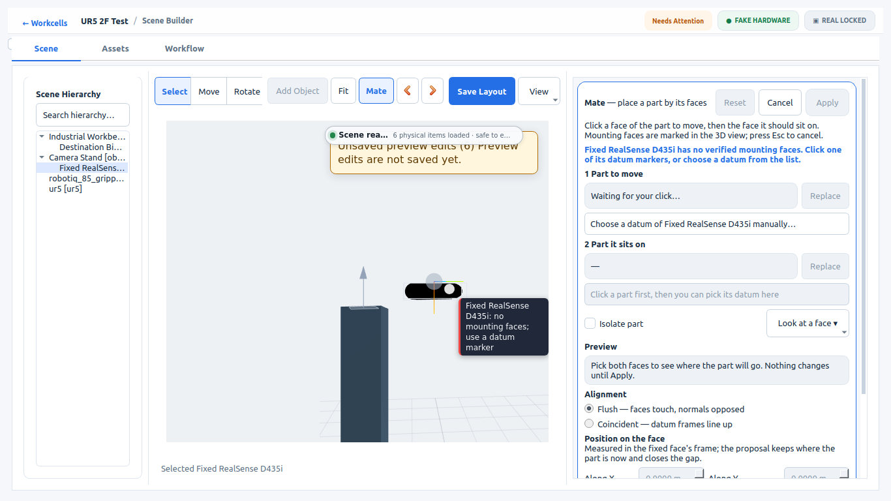
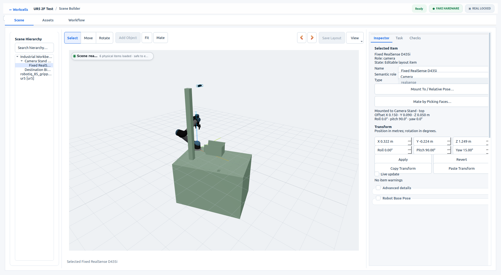

# Web3D poses as ROS fixed-axis RPY: acceptance

Follow-up to [Visual Mate Selection v1](visual-mate-selection-v1.md). Scene: `ur5_2f_test`. Fake hardware only; no robot motion was commanded (`execution_goals_sent: 0`).

## What was proven

Web3D now sets and reads every pose as ROS/URDF fixed-axis RPY, R = Rz(yaw)·Ry(pitch)·Rx(roll), which is three.js Euler order `ZYX`. That is the convention of the mounting resolver, native Scene3D, the generated URDF and RViz. Before this change Web3D used `XYZ`.

The case under test comes from Visual Mate Scenario B: the camera is mated pitched 90° on the camera stand, and the stand is then turned 15°. The camera's authored pose is rpy (0, π/2, 0.2618), a compound rotation that `XYZ` order draws 21.18° away from its true orientation. The new `--visual-mate-acceptance` steps check it after the stand turn and again on reopen.

| | `XYZ` viewer (base `abe5781d`) | ROS RPY viewer (this change) |
|---|---|---|
| Face click on the turned camera body | Refused, `STALE_VIEW`: "draws realsense_overhead 0.0 mm and 21.18° away from its authored pose" | Resolved on the D435 mesh: `NO_PLANE_DATUMS` (the camera has no mounting faces) |
| Drawn pose reported by Web3D | rpy (π/2, 1.309, π/2), 21.18° off | rpy (0, π/2, 0.2618), 0.0 mm and 0.0° off |
| Face normal in the camera frame | — | (0, 0, 1) exactly |

**Reopen (separate process).**
- Relations and poses equal `environment.yaml`.
- Selecting the turned camera reads back `selectedTransform.rpy = (0, π/2, 0.2618)` exactly through the editor bridge.
- The layout stays clean and `environment.yaml` is byte-identical, so no pose edit is echoed to Qt.

**Exported payload.**
- The exporter's owner-relative camera and table transforms, composed with the authored owner pose, reproduce the URDF FK.
- `validate_scene_builder_canvas_generated_parity._final_transform_mismatches` on the saved compound-camera cell: 0 mismatches.

**Native Scene3D.** The `--visual-mate-acceptance` run passes; the new steps are Web3D-only and skip on native.

| | | |
|---|---|---|
|  `XYZ`: body drawn turned, pick refused as a stale view |  ROS RPY: body drawn as authored, pick resolved |  Reopen: camera selected, layout clean |

Numbers: [`web3d-ros-rpy-v1/evidence.json`](web3d-ros-rpy-v1/evidence.json).

## Process exit

Authoring, reopen and native runs on this change exited 0. The final authoring run was made under gdb, which exited normally.

Three runs exited 139 (SIGSEGV) after "Product View owned server stopped":
- one earlier authoring PASS;
- one harness-development run;
- the `XYZ` "before" run.

This matches the pre-existing shutdown heap corruption fixed on `codex/web3d-teardown-fix` (3d83eab2), which is not in this stack. It also happens with the base viewer.

## Found, not fixed here

Mate's **Isolate part** hides every rendered root that is not the kept part or one of its ancestors. That includes the generated camera and table meshes, which are reparented under their owners. An isolated camera or table therefore shows only its outline and face clicks on it miss. The compound-pose step uses **Look at a face** without isolation.

## Reproduce

Use a disposable workspace whose `src/easy_manipulation_deployment` is a copy of this checkout. Source ROS and the workspace underlay, then run from the repository root:

```bash
workcell_builder --visual-mate-acceptance --workspace "$WS" --scene ur5_2f_test --smoke-output "$EVIDENCE"
workcell_builder --visual-mate-acceptance --workspace "$WS" --scene ur5_2f_test --smoke-output "$EVIDENCE" --reopen --window-size 1920x1080
WORKCELL_BUILDER_PRODUCT_VIEW_BACKEND=native_scene3d workcell_builder --visual-mate-acceptance --workspace "$WS2" --scene ur5_2f_test --smoke-output "$EVIDENCE/native"
```

For the "before" column, use the same binary in a copy whose `workcell_studio_web/viewer/viewer.js`, `workcell_studio_web/viewer/dist/` and `scripts/export_workcell_studio_web_scene_impl.py` are checked out from `abe5781d`.
