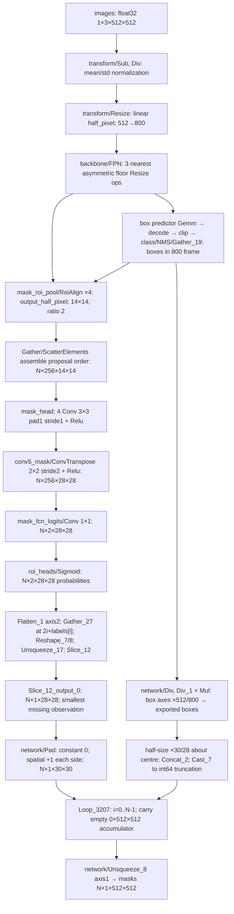
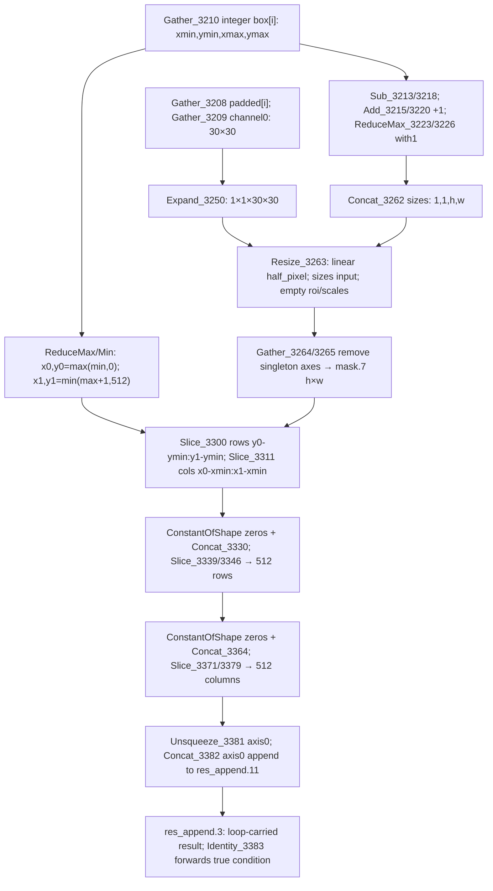

# Static segmentation graph — pinned ONNX opset 17

`graph.json.gz` is the machine-readable operator-level trace: 745 of 2411 top-level nodes, plus nested subgraphs including all 176 nodes of `Loop_3207`'s `sub_graph4`. Every selected node has its exact name, inputs, outputs, attributes and small constant values; relevant initializers have type, dimensions and protobuf hashes. Learned Conv/Gemm inputs terminate the ancestor walk; this is a mask/coordinate slice, not a complete backbone/RPN diagram. Scope cut tensors are recorded. Dimensions below are **STATIC DERIVED**, not observed internal tensors. `N` is dynamic; the previous exported output had N=3.





## Exact resize/alignment attributes

| Node(s) | Explicit attributes | Sizes / meaning |
|---|---|---|
| `/network/transform/Resize` | `mode=linear`, `coordinate_transformation_mode=half_pixel`, `nearest_mode=floor`, `cubic_coeff_a=-0.75` | `[1,3,800,800]` for this 512-square input; scale is min(800/512,1333/512), dimensions Floor then Cast |
| `/network/backbone/fpn/Resize`, `_1`, `_2` | `mode=nearest`, `coordinate_transformation_mode=asymmetric`, `nearest_mode=floor`, `cubic_coeff_a=-0.75` | Sizes taken from adjacent feature-map shapes |
| `Resize_3263` inside `Loop_3207` | `mode=linear`, `coordinate_transformation_mode=half_pixel`, `nearest_mode=floor`, `cubic_coeff_a=-0.75` | Inputs exactly `['mask','','','3846']`; sizes `[1,1,h,w]` |
| `/network/roi_heads/mask_roi_pool/RoiAlign`, `_1`, `_2`, `_3` | `coordinate_transformation_mode=output_half_pixel`, `output_height=14`, `output_width=14`, `sampling_ratio=2`; `spatial_scale=0.25/0.125/0.0625/0.03125` respectively | `mode` omitted: schema default `avg`; features 256 channels |
| `/network/Pad` | `mode=constant`; empty constant-value input defaults to zero | Constructed pads `[0,0,1,1,0,0,1,1]` in NCHW |

The local ONNX schemas selected by opset17 are retained in the graph artifact (Resize schema13, RoiAlign16). Resize `exclude_outside=0` and `extrapolation_value=0` are defaults. Neither Resize schema13 nor these nodes has an antialias attribute. `nearest_mode` is inactive for linear; `cubic_coeff_a` is inactive for linear/nearest. These attributes must not be interpreted as active cubic interpolation or nearest rounding on the paste path.

For linear half-pixel resizing of length `L` to `D`, source array index is `s(j)=(j+0.5)*L/D-0.5`, including D=1. Bilinear samples use clamped input-edge indices. The FPN nearest convention instead uses `floor(j*L/D)`. RoiAlign `output_half_pixel` scales ROI endpoints without the negative-half source offset of `half_pixel`; samples per axis are `start*scale + (bin+(sample+0.5)/2)*max((end-start)*scale,1)/14`, sample=0,1. This feature interpolation precedes the neural mask head; it is not the final mask paste.

## Box transforms, rounding and indexing

The box-predictor branch divides centre deltas by10 and log-size deltas by5, clips log-size deltas to maximum `4.135166645050049`, takes Exp, multiplies proposal widths/heights, and constructs centre ± half-size corners. Max with0 and Min with internal image dimensions clip boxes in the 800 frame. Class selection/NMS/Gather preserves box/label/index correspondence used by mask pooling. The trace includes this coordinate branch back to the learned predictor and the explicit RPN proposal cut.

The mask pool uses the internal-frame boxes; exported `boxes` are separately scaled by512/800. For each exported float32 box `b=[x0,y0,x1,y1]`, the paste path calculates:

```
c = (b[2:]+b[:2])*float32(0.5)
half = (b[2:]-b[:2])*float32(0.5)
a = half*float32(float32(30)/float32(28))
q = Cast_INT64(concat(c-a,c+a))       # truncate toward zero, not Floor or round
w = max(q[2]-q[0]+1,1); h = max(q[3]-q[1]+1,1)
dst = [max(q[0],0),max(q[1],0),min(q[2]+1,512),min(q[3]+1,512)]
source_slice = dst - [q[0],q[1],q[0],q[1]]
sx(x) = (x-q[0]+0.5)*30/w-0.5
sy(y) = (y-q[1]+0.5)*30/h-0.5
```

`Slice` ends are exclusive; the graph explicitly adds1 to the quantized maximum corner. Clipping crops the already resized image rather than resizing to the clipped dimensions. Zero blocks and concatenations place that cropped image at the correct image offset. There is no sigmoid or threshold after Resize. No mask threshold occurs on this output path: exported masks remain float32; the retained external gate later uses strict `>0.5`.

Class selection uses `Flatten_1(axis=2)` → `[N*2,784]`, `Range_1` → indices i, `Mul_8`/`Add_8` → `2*i+labels[i]`, `Gather_27(axis=0)`, reshapes and singleton-channel insertion. `Slice_12` limits axis0 to the label count. Loop trip count comes from Shape(Pad)[0]; the initial accumulator is float32 `[0,512,512]`, and its condition is constant true. Each iteration gathers the same i from padded masks and quantized boxes and concatenates the pasted 512 image into the **loop-carried accumulator**, not an ONNX scan output. Final Unsqueeze inserts the channel axis.

## Confirmed effects and unmeasured causes

Confirmed graph behaviour: image/FPN/RoiAlign resampling changes the features supplied to the head; ConvTranspose changes head spatial dimensions; sigmoid preserves logit ordering and maps zero to0.5; spatial padding introduces zero-valued border samples; box expansion changes the paste extent; truncation can shift corner placement by less than1 index relative to the expanded float edge; inclusive endpoints change resize dimensions; bilinear interpolation redistributes probabilities; clipping/zero placement can remove support outside the image. Bilinear weights are nonnegative: no output can exceed0.5 unless at least one contributing interior probability exceeds0.5. High head samples may nevertheless land on rendered background because of box geometry/interpolation/alignment.

Unmeasured: actual selected 28×28 values, their precise threshold contours, and how much spill each operation causes for these detections. A high head probability is not itself proof of a learned segmentation error without defining its continuous image support. Static topology and exported masks do not invert interpolation uniquely. No alternative convention, erosion or adjusted box is applied to genuine masks here.
